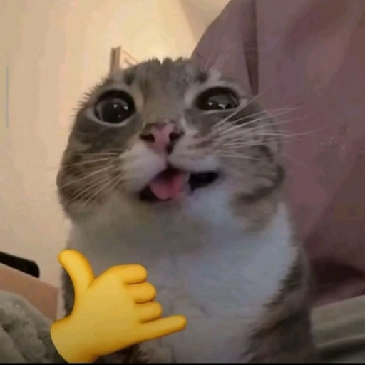

<p align="center">
  
</p>

<h1 align="center">⚾ HYPER ATTACK ⚾</h1>

<p align="center"><b>hit the ball. hit it harder. do NOT get hit by the ball.</b></p>

<p align="center">
  a game made in one (1) day at <b>Hack Club Haven London</b> 🇬🇧<br>
  by <b>Imran, Daniel, Binyamin, Naeem and Oluwasemilore</b>
</p>

---

## 👋 hey guys!!!

**welcome to HYPER ATTACK!!!** this is the game we made for the **Haven London game jam** on Saturday 14 November 2026. we turned up, got put into a random team, looked at each other, and said "what if Lethal League but worse at first and then actually kind of good". this is the result.

it's a 2.5D ball-smacking fighting game made in **Godot**. there's a ball. you hit it. every time anyone hits it, it gets faster. if the *other* player's ball hits *you*, you lose a life. that's genuinely the whole game and it is genuinely very stressful.

we also have a penguin, a cat, a mouse and a floating head with glasses. no further questions.

---

## 🧠 the rules (all 3 of them)

1. **smack it.** swing at the ball and it becomes YOUR colour. every hit makes it faster.
2. **aim it.** hold up or down while you hit to send it up or down. hold forward too for a flatter angle. hold nothing and it goes roughly at your opponent anyway, because we are kind.
3. **don't get hit.** if THEIR ball touches YOU, you lose a life. last one standing wins. your own ball can't hurt you, so go absolutely wild.

### the spicy extras 🌶️
- **charge your swing:** hold the swing button to wind up, then let go. the longer you hold, the faster it goes. a full charge can push the ball past its normal top speed, and then it's the other person's problem.
- **bunt:** a little pop-up. it makes the ball neutral but keeps the speed, so you can set yourself up for something disgusting.
- **specials:** hitting the ball fills your meter. when it flashes, press special. every character's is different (see below).
- **speed sticks around:** charged it up to 140 and they hit it back? congrats, it's THEIR 140 now. think about that.

---

## 🎮 controls

two people, one keyboard, zero personal space.

| | 🔴 player 1 | 🔵 player 2 (numpad!) |
|---|---|---|
| move | `A` `D` | `4` `6` (or arrows) |
| jump (hold = aim up) | `W` | `8` (or ↑) |
| fall fast / aim down | `S` | `5` (or ↓) |
| swing (**hold to charge**) | `F` | `1` (or `K`) |
| bunt | `G` | `2` (or `L`) |
| special | `H` | `3` (or `;`) |

- **vs CPU:** player 1 can use either side of the keyboard, or the **mouse** (left click = swing, right click = special).
- **gamepads** work too: `A` jump, `X` swing, `B` bunt, `Y` special.
- **Esc** pauses: resume, restart, controls, change characters, options (CPU level, timer, lives), or back to the menu.
- before every match there's a **GET READY** screen with everyone's controls. press **Enter** when you're ready. this exists because we KNOW someone is going to stand there going "wait which one is jump".

---

## 🧑‍🤝‍🧑 the roster

| | who | special | the vibes |
|---|---|---|---|
| 🤓 | **NERDO** | ⏱️ **TIME STOP**: freezes everyone else for 2 seconds. you can still hit the ball while it's frozen. | a floating head who worked out every bounce angle in the arena before his first match. nobody has seen what's behind the glasses. nobody wants to. |
| 🐭 | **MOUSE** | 🦘 **DOUBLE JUMP**: always has a second jump. special = super hop. | works the fryer at the burger place on weekends. small, fast, and hardly ever on the ground. |
| 🐧 | **PRIVATE** | 🪐 **ZERO-G**: the ball goes neutral and floats. free for all. | the youngest of a very serious penguin squad and the only one who's having fun. follows orders well, takes hits badly. |
| 🐱 | **MACDONALD** | 🍯 **SLOW BALL**: the ball crawls for 3.5 seconds. breathe. | runs the snack bar by the arena and has never once been in a hurry. waits for everyone else to panic. |

the CPU comes in **easy**, **normal** and **hard**. hard will charge its swings at you. hard is not your friend.

---

## ✨ stuff in the game

- 🖥️ title screen → main menu → character select → GET READY → match → results, all with menus that slide, wobble and slam around like they've had three energy drinks
- ⚾ a ball that goes from "aww" to "oh no" in about six hits
- 💥 big-hit freeze frames: the screen drains, the camera punches in, everything shakes
- 📻 a **boombox** that shows the ball speed in dot-matrix numbers, because Lethal League did it and it's the coolest thing ever
- 🔥 **Burst** counter for long rallies
- 🏆 a results screen with your character in 3D, your K.O.s, hits and fastest hit, so you have proof
- 🔊 a final K.O. sound that goes extremely hard
- 🎛️ options for lives, timer, CPU difficulty, volume and fullscreen, saved between sessions
- 🐈 an icon that perfectly captures the energy of the project

---

## 🚀 how to run it

1. download **[Godot 4.3 or newer](https://godotengine.org/download)**. the normal one, not .NET.
2. clone or download this repo.
3. open Godot → **Import** → pick `project.godot` → **Import & Edit**.
4. press **F5**.
5. hit the ball.

### putting it on itch.io
1. in Godot: **Editor → Manage Export Templates → Download**.
2. **Project → Export → Web** (already set up for you, you're welcome) → export to `build/web/index.html`.
3. zip everything *inside* `build/web` and upload it to itch as an **HTML** game, with a 1280 x 720 viewport.
4. thread support is off, so you don't need to fiddle with SharedArrayBuffer. we suffered so you don't have to.

---

## 🎨 add your own stuff (no coding!)

everything is built so you can just **drop files in** and they replace the placeholders. full guide: [`assets/ADD_YOUR_ASSETS.md`](assets/ADD_YOUR_ASSETS.md). the short version:

| folder | what goes in it |
|---|---|
| `assets/characters/` | `nerdo.glb`, `mouse.glb`… (3D models, sized and outlined automatically) plus `nerdo_portrait.png` etc. |
| `assets/stage/` | `stage.glb` to replace the grey box arena, `background.png` for far behind it |
| `assets/sfx/` | any sound by name: `hit.wav`, `ko.ogg`… you can even give each menu button its own sound (`menu_select_versus.wav`) |
| `assets/music/` | `menu.ogg`, `match.ogg`, and `music.ogg` (plays while paused) |
| `assets/ui/` | `logo.png`, backgrounds, `boombox.png`, `profile.png` |
| `assets/fonts/` | `main.ttf` swaps the font everywhere |

---

## 🗂️ what's where

```
hyper-attack/
├── scripts/
│   ├── game.gd       # characters, settings, controls, loading screen, asset lookup
│   ├── frontend.gd   # title screen, main menu, options, how to play, credits
│   ├── select.gd     # character select (big renders, portrait strip, START GAME)
│   ├── match.gd      # the actual game: stage, hits, K.O.s, specials, juice
│   ├── fighter.gd    # movement, swinging, charging, the CPU's brain, animations
│   ├── ball.gd       # the ball. the star of the show. the menace.
│   ├── hud.gd        # boombox, life pips, meters, hit effects
│   ├── pause.gd      # esc menu + the GET READY screen
│   ├── results.gd    # who won and by how much
│   ├── sfx.gd        # placeholder beeps + loading your sounds
│   └── ui_bg.gd      # the yellow/black menu look and the slanted buttons
├── scenes/           # tiny scenes, almost everything is built in code
├── assets/           # your stuff goes here (see above)
└── icon.png          # 🐈🤙
```

---

## 🛠️ want to tweak it?

| i want… | change this |
|---|---|
| a longer bat | `SWING_RANGE` in `scripts/fighter.gd` |
| charging to take longer | `CHARGE_FULL` in `scripts/fighter.gd` |
| the ball to start faster or slower | `BASE_SPEED` in `scripts/ball.gd` |
| a higher top speed | `MAX_SPEED` / `CHARGED_MAX` in `scripts/ball.gd` |
| different abilities per character | the list at the top of `scripts/game.gd` (the ability goes with the slot) |
| new bios | also `scripts/game.gd` |
| different tips | `_build_tips()` in `scripts/hud.gd` |

---

## 📊 completely real statistics

- times someone said "ok one more round": too many
- times the bat went through a penguin before we fixed it: classified
- characters who are just a head: 1
- characters who are a cat in a burger uniform: also 1, somehow
- seconds a full charge takes: 0.8
- seconds it takes the other person to scream: about 0.3

---

## 🙏 credits

**made by** Imran, Daniel, Binyamin, Naeem and Oluwasemilore at **Hack Club Haven London** 💛

**characters**
- "Private" by gaddiellartey2010, [CC BY 4.0](https://creativecommons.org/licenses/by/4.0/), [Sketchfab](https://sketchfab.com/3d-models/private-c874448fe82a45448f7fad5adb0763ba)
- "Nerdo" by Drawnah, [CC BY 4.0](https://creativecommons.org/licenses/by/4.0/), [Sketchfab](https://sketchfab.com/3d-models/nerdo-a3da6439a8d94ae9b340eee6fc2d3354)
- "MacDonald" and "Macdonald Mouse" by Kasugay, Sketchfab Standard licence

**massive inspiration:** *Lethal League Blaze* by Team Reptile. go play it, it's incredible.

**thank you** to Hack Club and everyone at Haven London for running the jam and putting up with the chaos. 🫶

---

<p align="center"><i>no penguins were harmed in the making of this game. one was hit with a baseball bat several hundred times, but he's fine. he's a professional.</i></p>
